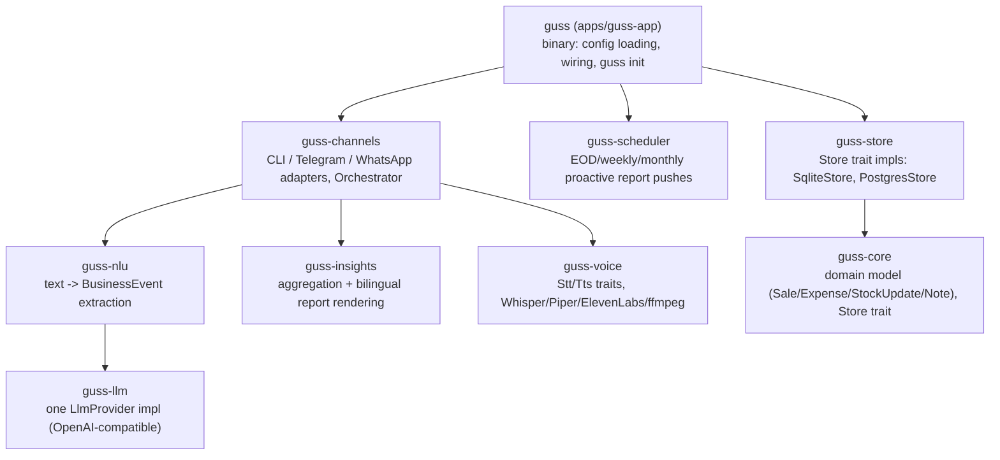
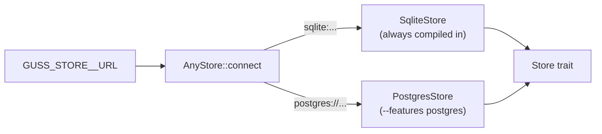
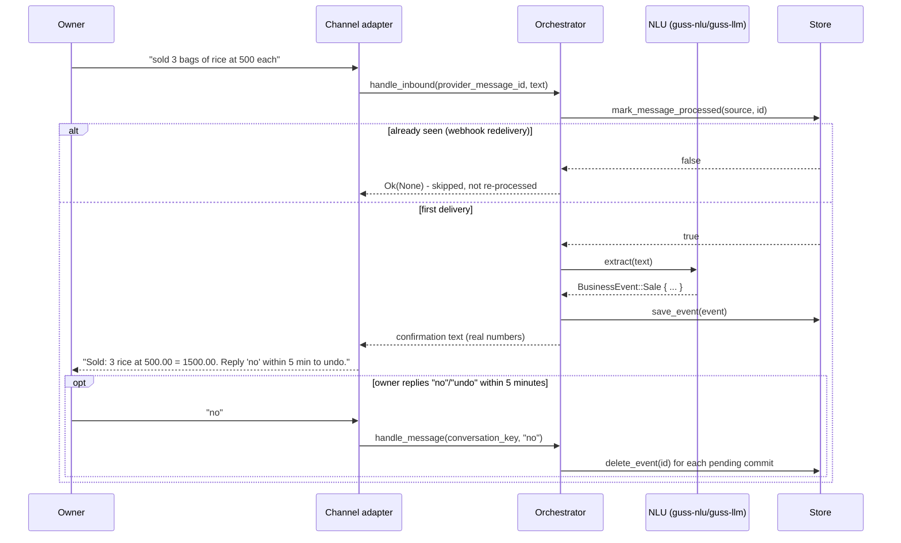
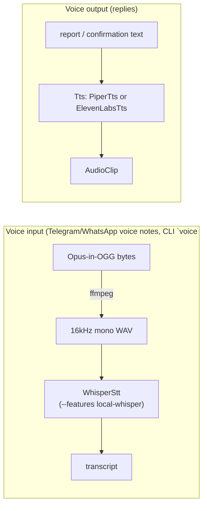

# Architecture

Guss is a Cargo workspace. Each crate has one job and depends only on
the crates below it - nothing cyclic, nothing that needs to know about
the UI layer to do its own job.

Storage is the one place with two implementations behind one trait -
see [Storage](#storage-guss-store) below for how `guss-app` picks between
them at runtime.

## Domain model (`guss-core`)

A `BusinessEvent` is one of `Sale`, `Expense`, `StockUpdate`, or `Note`.
Money is stored as integer minor units (`Money { minor_units: i64 }`)
plus a currency code, never as a float - this avoids rounding drift
across thousands of small transactions. Zero-decimal currencies (IDR,
JPY, KRW, ...) are handled via a small static list, the same convention
Stripe uses.

**Current stock is derived, not stored.** A sale doesn't need to also
emit a synthetic stock-decrement event; `current_stock(item)` is computed
at query time as `SUM(StockUpdate.delta) - SUM(Sale.quantity)`. This
keeps the NLU layer's job simple: one utterance, one event.

Guss is **single-business-per-instance** in this phase. Every row still
carries a `business_id` so a future multi-tenant mode wouldn't need a
schema migration, but there's no multi-tenant auth/isolation logic - one
running Guss serves one business.

## Storage (`guss-store`)

`Store` is a trait with two implementations: `SqliteStore` (default) and
`PostgresStore` (behind the `postgres` Cargo feature). The schema is one
`events` table with both indexed columns (for fast aggregation) and a
full JSON `payload` column (for a lossless round-trip back into
`BusinessEvent`) - this avoids needing separate tables per event kind
while still letting `guss-insights` do real SQL aggregation instead of
parsing JSON per row. Shared row-mapping logic (`columns_for` and
friends) lives in `event_columns.rs` so both backends stay in sync from
one implementation.

**Runtime dialect selection.** `apps/guss-app` is generic over one
concrete `S: Store` (same as every channel adapter - see Channels
below), so picking a backend at runtime without turning every generic
site into a trait object is done with a small enum, `AnyStore`
(`crates/guss-store/src/any.rs`): it wraps either `SqliteStore` or
(feature-gated) `PostgresStore` and forwards each `Store` method to
whichever variant is active. `AnyStore::connect` reads the scheme off
`GUSS_STORE__URL` - `sqlite:` or `postgres://`/`postgresql://` - and
fails fast with a clear message if you ask for Postgres without having
built with `--features postgres`.

Document retrieval (for NLU context - see below) uses SQLite's FTS5
full-text search on `SqliteStore`, confirmed working in this repo's own
test suite against the bundled `libsqlite3-sys` build. `PostgresStore`
gets the same OR-of-keywords retrieval behavior from a generated
`tsvector` column plus `websearch_to_tsquery` instead of FTS5 - no
triggers needed, since Postgres maintains the generated column itself.

**Testing.** `SqliteStore`'s test suite runs as part of the default
`cargo test --workspace`. `PostgresStore`'s equivalent suite is
`#[ignore]`d and reads `GUSS_TEST_POSTGRES_URL` from the environment, so
it only runs where a real Postgres is available - locally if you set
that variable, or in CI's `postgres-integration` job against a
`postgres:16-alpine` service container (see
`.github/workflows/ci.yml`).

## LLM extraction (`guss-llm`, `guss-nlu`)

One `LlmProvider` implementation (`OpenAiCompatibleProvider`) talks to
any OpenAI-compatible `/chat/completions` endpoint - this is the same
code path for Ollama, Groq, and OpenAI, selected purely by `base_url`/
`api_key`/`model` config.

**Structured output, not just prompted JSON.** Plain `response_format:
json_object` only guarantees syntactically valid JSON, not schema
compliance - real-world failure rates for that alone run 5-10%. Guss
sends the actual JSON Schema (derived via `schemars`) as
`response_format: {"type": "json_schema", "json_schema": {...,
"strict": true}}`, which constrains decoding directly on providers that
support it (Ollama 0.3+, Groq, OpenAI). The schema is also described in
the prompt text as a second line of defense, and a parse failure gets
up to 2 retries - feeding the model its own bad output and the parse
error - before giving up with `NluError::Unparseable`. That error is
surfaced to the user ("I couldn't understand that") rather than
silently dropped.

**Language is a per-instance setting**, not detected per message. One
Guss instance serves one business in one language (`en` or `id`),
chosen once via `guss init` - this is simpler and sufficient for the
single-business-per-instance scope, and is a deliberate simplification,
not an oversight.

**Document context (lightweight RAG)**: a business owner's uploaded
reference docs (price lists, supplier notes) are retrieved via SQLite
FTS5 keyword search on a few extracted keywords from the inbound
message, and the top 3 snippets are injected into the NLU system prompt.
No embeddings, no vector DB - appropriately lightweight for a few
hundred rows of reference text.

## Confirmation-before-commit and undo

Every extracted event is written to the store immediately (so the
owner's confirmation message shows real numbers), but the
`Orchestrator` (in `guss-channels`) tracks the just-committed event IDs
per conversation with a timestamp. Replying "no"/"undo" (or
"tidak"/"batal") within 5 minutes deletes those events via
`Store::delete_event`. This is the direct mitigation for LLM
misextraction: schema-valid output can still contain the wrong number,
and the owner needs a real, bounded chance to catch it - not a vague
"did you mean...?" before anything is saved, which would slow down the
common case where extraction is correct.

## Channels (`guss-channels`)

Each channel adapter (`cli`, `telegram`, `whatsapp`) converts its
transport's inbound message into a call to `Orchestrator::handle_message`
or `Orchestrator::handle_inbound`, and renders the reply back out.

**Webhook redelivery is normal, not an edge case.** Both Telegram
(long-poll timeout) and WhatsApp (Meta's retry policy) can redeliver the
same update. `Orchestrator::handle_inbound` deduplicates by the
provider's own message ID via `Store::mark_message_processed` before
any processing happens - a redelivered update is silently skipped
(`Ok(None)`), not re-processed and re-replied-to.

**Bounded concurrency, not one task per message.** Both Telegram and
WhatsApp use `Arc<Semaphore>::acquire_owned()` *before* `tokio::spawn`,
tracked in a `JoinSet` - a message burst is capped at 8 concurrent
handlers rather than spawning unboundedly many tasks.

**WhatsApp signature verification.** Every webhook POST's
`X-Hub-Signature-256` header is checked via HMAC-SHA256 against the
Meta app secret before the raw body is trusted - without this, anyone
who discovers the webhook URL could inject fake ledger entries.

**WhatsApp is the official Cloud API**, not an unofficial WhatsApp Web
bridge. This was a deliberate choice: an unofficial bridge is faster to
set up but risks the business's WhatsApp number being banned for
violating WhatsApp's terms of service. The Cloud API path costs more
setup time (a Meta Business app, webhook verification, a public HTTPS
URL) but doesn't carry that risk - see
[setup-whatsapp-cloud-api.md](setup-whatsapp-cloud-api.md).

## Insights and reporting (`guss-insights`)

Aggregation is done in Rust over `Store::list_events` results, not in
SQL - at the data volumes a small business actually generates (hundreds
to low thousands of rows), this is simpler and keeps the aggregation
logic portable across storage backends.

A few things are deliberately **best-effort, and documented as such**:

- **Gross margin** is only computed for items where a restock in the
  same window also recorded a `unit_cost` - otherwise only cash-basis
  net (revenue - expenses) is shown. True COGS needs purchase-cost data
  the LLM can't infer from a sale utterance alone.
- **"Declining, no threshold set"** items are surfaced as a separate
  bucket: items with a negative net stock movement in the window that
  never had a reorder threshold configured. This exists so an item
  doesn't silently vanish from the report just because no threshold was
  ever set for it.
- **MRR-style projection** normalizes recurring Sale/Expense rows onto a
  monthly figure (`weekly * 4.33`, `daily * 30`) grouped by a free-text
  label. This is a simple projection, not real subscription-cohort MRR -
  logging the same recurring item twice within one report window would
  double-count it.

Reports render through `handlebars` templates in `templates/en/` and
`templates/id/` into the string handed to TTS and/or sent as text.

## Voice (`guss-voice`)

- **STT**: local Whisper via `whisper-rs`, gated behind the
  `local-whisper` Cargo feature (on by default *at the `guss-voice`
  crate level*, but the `guss` binary and `guss-channels` depend on it
  with `default-features = false` - the binary only gets Whisper if you
  build with `--features local-whisper`). `whisper-rs-sys` compiles
  whisper.cpp via CMake and needs a C/C++ toolchain - this is a real,
  unavoidable prerequisite for any whisper.cpp binding, not something
  Guss can paper over. Configured for greedy decoding at temperature 0,
  tuned `logprob_thold`/`entropy_thold`, and optional Silero VAD
  pre-filtering - the actual mitigations for whisper.cpp's documented
  hallucinate-stock-phrases-on-silence behavior. Verified end-to-end in
  CI (the `whisper-e2e` job in `.github/workflows/ci.yml`) against a real
  synthesized speech sample: `espeak-ng` generates the audio, it's run
  through the same `ffmpeg` conversion real voice notes use, then through
  `WhisperStt`, and the transcript is asserted to contain the expected
  words.
- **TTS**: `PiperTts` (shells out to the official `piper` CLI binary -
  no mature pure-Rust Piper binding exists) is the free, local default;
  `ElevenLabsTts` is a straight HTTP client, swappable with zero code
  changes elsewhere since both just implement the `Tts` trait.
- **Audio conversion**: incoming voice notes (WhatsApp/Telegram both use
  Opus-in-OGG) are converted to 16kHz mono WAV via `ffmpeg`, shelled out
  to rather than decoded with a pure-Rust crate - Symphonia's Opus
  support isn't production-ready as of when this was built.

## Scheduler (`guss-scheduler`)

Wraps `tokio-cron-scheduler`. A `ReportSink` trait abstracts "where does
a scheduled report go" - `TelegramReportSink` and `WhatsAppReportSink`
push to the owner's configured chat/number; CLI has no persistent
destination, so it has no sink (on-demand "report" still works there).

Each scheduled job carries its own in-flight guard (`AtomicBool`) - if a
previous tick (slow LLM call, stalled HTTP send) hasn't finished when
the next one fires, the new tick is skipped and logged rather than
piling up concurrent runs.

## Why this shape

The architecture choices above came out of two things: an explicit
decision to keep each concern in its own crate so it's independently
testable (every crate above has its own `#[cfg(test)]` suite, and
`cargo test --workspace --no-default-features` is green), and a
deliberate research pass on how similar systems - LLM-based extraction
pipelines, voice bots, webhook-driven services - actually fail in
production, rather than assuming the naive version of each piece would
be fine. The confirmation/undo flow, structured-output extraction,
webhook dedup, bounded concurrency, and Whisper hallucination tuning
described above are the direct result of that research, not
afterthoughts.
